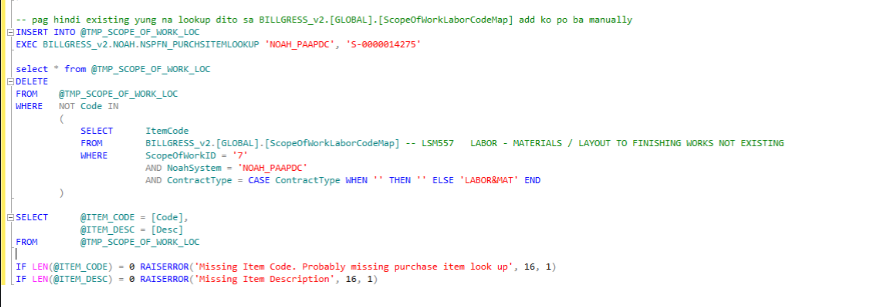

# Common Issues
  ## Table of Contents
  - [Granting Access](#granting-access)
  - [Billgress PR](#billgress-pr) 
    - [Production month date not appearing](#production-month-date-not-appearaing)
    - [BOM not appearing](#bom-not-appearing)
    - [Unable Save PR Processing](#unable-save-pr-processing)
  - [Billgress PO](#billgress-po)
    - [Materials not appearing](#materials-not-appearing)
    - [Failed PO saving](#failed-po-saving)
    - [Missing Item Code or Description](#missing-item-code-or-description)
  - [Debugging ASP runner](#debugging-asp-runner)
  - [Billgress House Accomplishment](billgress-house-accomplishment)
    - [PO not appearing in the selection](#po-not-appearing-in-the-selection)
    - [Discrepancy in Billing](#discrepancy-in-billing)
  - [Billgress RFP](#billgress-rfp)
    - [No RFPGEN is generated](#no-rfpgen-is-generated)
  - [SQL Scripts](#sql-scripts)
    - [Manual Migration of PR PO to Billgress](#manual-migration-of-pr-po-to-billgress)
    - [PR & PO notification](#pr-&-po-notification)
    - [Procurement Dashboard Scripts](#procurement-dashboard-scripts)
    
  ---
  # Granting Access
  Through the [LDAP](https://prod.paproperties.com.ph/ldap/) system click add new role look for the user. Select role as *User*.
  
  [Billgress Outsystem version](https://prod.paproperties.com.ph/BillGressv2/) 
  * Setup select the user and assign which module or system he/she needs.
  
  # Billgress PR
  
  ## Production month date not appearing
  There are list of issues if the production month date is not appearing.
  1. No Noah Cotime Created. 
  2. No Cotime per sow
  3. There's a **Restriction** in place if the Contract Type `Admin` requestor can only request only within a span of
  **6 MONTHS**. Beyond the 6 months period. The requestor can't process the PR 
  4. Noah Cotime and Cotime per SOW don't match on the duration of the date. if the user can't create a Cotime per SOW. 
  * The requestors need to change the Construction date of the Noah Cotime
  
  ## BOM not appearing
    Take note most cases the requestor is not aware of the process.
  Please check the store procedure `[WILP].[PR].[NSP_Bill_Of_Materials]` for BOM.
  There are certain criterias to be meet in order for the BOM to load
  1. The units need to have a Noah Cotime created & have a existing BatchNo. Look for the table `RE.[COTIMELIN]` to verify.
  2. No setup by Cost Dept in **Noah Extension** system
  3. For special scope of work
  * Completion Works.
  * Glazing Works.
  * Layout out finishing.
    * Need an aditional setup. 
    
  select any bom and assigned the special scope of works
  4. the unit has an existing PR.
  5. Old BOM setup. Request the cost dept to have it setup.

  ## Unable Save PR Processing
  Please check the store procedure `[WILP].[NSP_SavePurchaseRequest]` 

    NOTE: For debugging purposes of PR saving. Run the project WarehouseInventoryLogisticPortal through your local.
    Go to the file /Classes/PurchaseRequest/PurchaseRequest.cs  .
  
  revert back if your debugging is done.
  
  
  1. If the error shows no sublocation. 
  * The user has no existing setup associated to the **Project/Phase**
  2. 0 Qty for the materials.
  3. Validation for processing will fail due to 
  * Has existing PR
  * No Noah Cotime
  * No Cotime per SOW.

  ---
  # Billgress PO
  
  ## Materials not appearing 
  If Current selected supplier of requestor doesn't appear on the consolidated materials.
  * Setup the supplier to have a setup of the material 
  
  ## Failed PO saving
  The issue comes from the other server due to config **Distributed Transaction** not enabled from the *SERVER* 
  * Request for the DB Admin to enabled distributed transaction on the specified server

  ## Missing Item Code or Description
  Upon saving of PO, if the error is `Missing Item Code or Description` it is due to Missing Item Code setup for the Supplier.

  For Reference
  

  Copy the supplier code selected by the user to this script
  * `EXEC BILLGRESS_v2.NOAH.NSPFN_PURHSITEMLOOKUP <SYSTEM>, <Suplier Code>`

  In the table `ScopeOfWorklaborCodeMap` the ItemCode exists from the executed SP.
  * Manually insert the ItemCode inside the table of `ScopeOfWorkLaborCodeMap`.
  
  ---

  # Debugging ASP runner 
  * Run the application & open dev tool in the browser and check the logging to know what store procedure is executed.
  ---
  # Billgress House Accomplishment

  ## PO not appearing in the selection
    Store Procedure for loading the list of PO. 
    BILLGRESS_v2.[HOUACC].[NSP_HouseAccomplishment] @Flag=0;
    
    
  No contract uploaded. Request a copy of the Contract to verify there's an existing contract.
  if there's an existing actual contract 
  * Manually insert the contract details to the table `BILLGRESS_v2.[CNTRCT].[ContractEntryHDR]`.

  ## Discrepancy in Billing
  If user has an issue or discrepancy in POC, Amount, Unit 
  **request the user to delete the billing** just make sure no RFP is created yet.
  just revert the status of the `HouseAccomplishmentHDR` status to 2 and ask the user to delete it on their end.

  # Billgres RFP 

  ## No RFPGEN is generated
  if the RFP report has no generated *RFPGEN* 
  make sure the **PO** exists and the **Billing No** in this table `[REQPAY].[RequestForPaymentHDR]`.
  
  `[COST_CONSTRUCTION].[CCM].[Contractor_Billing]` if the column **RFPGEN_NO** is null.

  run this script. 

    EXEC [CCM].[NSP_Tag_As_RFP_Created]
       @SYSTEM     = '<Noah System>', //NOAH_PAHANKYU02
       @PURCHS_NO  = '<PONumber>', // #1234
       @HSEACM_NOS = '<TransactionNo>', //NOAH_PHVECTORONE_HEIGHTS-PURCHS-HO000001-00000000000549-003
       @BGSRFP_NO  = '<GRPFP>', //GRFP-XXXXXX
       @STATUS     = 'For Approval of RFP',
       @IS_LIVE    = 1

  once run check the `[COST_CONSTRUCTION.[CCM].[Contractor_Billing] WHERE [HSEACM_NO] = <Input transaction no>` check if the column **RFPGEN_NO** has a value

---

# SQL Scripts
## Manual Migration of PR PO to Billgress
Some user bypass Billgress to create PR & PO in **NOAH** 
#### Take note this is not advisable! 

For PR & PO that is already created. **Run this script.**
 * [Manual PO Uploading V2](./sql/Manual_PO_Uploading_V2.sql)

 Input all required variables 
 ```
 DECLARE @CONTRACT_TYPE VARCHAR(80) = ''
 DECLARE @NOAH_SYSTEM VARCHAR(80) = ''
 DECLARE @RECUSER VARCHAR(80) = ''
 DECLARE @SCOPE_ID VARCHAR(80) = ''
 DECLARE @PHASE_CODE VARCHAR(80) = ''
 ```

for Debugging. in the last line `ROLLBACK TRANSACTION` is the default for testing & validation of the data.

## PO & PR Notifaction
A notication is sent to procurement & approvers
List of Recipients are found in this table 
* `SELECT * FROM [GLOBAL].[AccountsNotified]`
## PR notification 
The Script is inside the table `PR.PurchaseRequestHDR` as trigger. Modify the template for updates.This is only for pending PR needed to be approved by the approver.
Store procedure are found in database `[NOAH DATAWHSE]` Schema `[BG]`
* `NSP_PRReminderPendingForApproval`

## PO Notication 
Store procedures List at database `[NOAH DATAWHSE]` Schema `[BG]`
* `NSP_PONotificationForDelivery` //for sending
* `NSP_POReminderForDeliveryQty` // List of PO for deliver
* `NSP_ReminderPRWithNoPO` //Reminder to create PO for PR with no PO


## Procurement Dashboard
List of dependencies `[NOAH DATAWHSE]` Schema `[BG]`
* `NSP_SynchUnitsWithPRAndPO` 
* `[NOAH].[NSP_E0101_PO STATUS]` 
* `[NOAH].[NSP_E0301_PR_STATUS_Report] `
