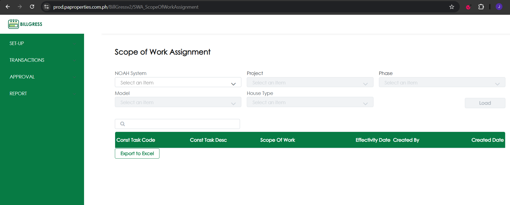
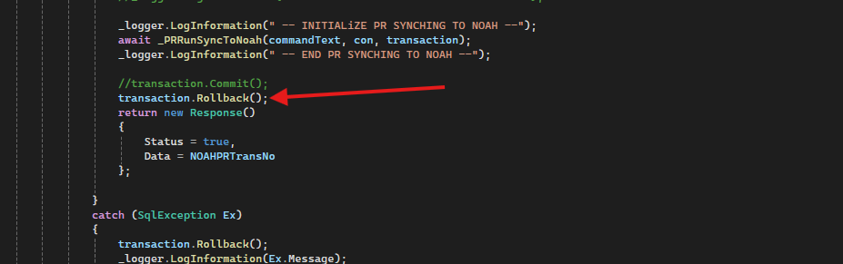

# Common Issues
  ## Table of Contents
  - [Granting Access](#granting-access)
  - [Billgress PR](#billgress-pr)
    - [Production month date not appearing](#production-month-date-not-appearing)
    - [BOM not appearing](#bom-not-appearing)
    - [Unable to save PR processing](#unable-to-save-pr-processing)
  - [Billgress PO](#billgress-po)
    - [Materials not appearing](#materials-not-appearing)
    - [Failed PO saving](#failed-po-saving)
    - [Missing Item Code or Description](#missing-item-code-or-description)
  - [Debugging ASP runner](#debugging-asp-runner)
  - [Billgress House Accomplishment](#billgress-house-accomplishment)
    - [PO not appearing in the selection](#po-not-appearing-in-the-selection)
    - [Discrepancy in Billing](#discrepancy-in-billing)
  - [Billgress RFP](#billgress-rfp)
    - [RFPGEN is missing](#rfpgen-is-missing)
  - [SQL Scripts](#sql-scripts)
    - [Manual migration of PRs and POs to Billgress](#manual-migration-of-prs-and-pos-to-billgress)
    - [PR and PO notifications](#pr-and-po-notifications)
    - [Procurement Dashboard](#procurement-dashboard)
    
  ---
  # Granting Access
  In [LDAP](https://prod.paproperties.com.ph/ldap/), click **Add New Role**, find the user, and set the role to *User*.
  
  [Billgress OutSystems version](https://prod.paproperties.com.ph/BillGressv2/)
  * In Setup, select the user and assign the modules or systems they need.
  
  # Billgress PR
  
  ## Production month date not appearing
  Check the following possible causes if the production month date is missing.
  1. No Noah Cotime has been created.
  2. There is no Cotime per SOW.
  3. For the `Admin` contract type, the requester can process a PR only within
  **six months**.
  4. The date ranges for Noah Cotime and Cotime per SOW differ.
  * If the requester can't create a Cotime per SOW, ask them to change the construction date in Noah Cotime.
  
  ## BOM not appearing
    The requester may need help with the BOM setup.
  Check the stored procedure `[WILP].[PR].[NSP_Bill_Of_Materials]` for the BOM.
  Check the following conditions when the BOM fails to load.
  1. The units need a Noah Cotime and an existing BatchNo. Verify both in `RE.[COTIMELIN]`.
  2. Check whether the Cost Department has completed the setup in **Noah Extension**.
  3. Check for a special scope of work.
  * Completion Works.
  * Glazing Works.
  * Layout finishing.
    * These scopes require additional setup.
    
  Select a BOM and assign the special scope of work.
  4. Check whether the unit already has a PR.
  5. If the BOM setup is outdated, ask the Cost Department to update it.

  ## Unable to save PR processing
  Check the stored procedure `[WILP].[NSP_SavePurchaseRequest]`

    To debug PR saving, run the WarehouseInventoryLogisticPortal project locally.
    Open /Classes/PurchaseRequest/PurchaseRequest.cs.
  
  Revert your changes when you finish debugging.
  
  
  1. If the error indicates a missing sublocation, check the user's setup.
  * The user may lack a setup for the **Project/Phase**.
  2. Check whether the material quantity is zero.
  3. PR validation will fail for any of the following reasons.
  * An existing PR
  * A missing Noah Cotime
  * A missing Cotime per SOW

  ---
  # Billgress PO
  
  ## Materials not appearing
  If the selected supplier is missing from the consolidated materials, verify the supplier's material setup.
  * Configure the material for the supplier.
  
  ## Failed PO saving
  This issue occurs when **Distributed Transaction** is disabled on the other server.
  * Ask the database administrator to enable distributed transactions on the affected server.

  ## Missing Item Code or Description
  If saving the PO returns `Missing Item Code or Description`, the supplier's item code setup is missing.

  For Reference
  

  Use the supplier code selected by the user in the following command.
  * `EXEC BILLGRESS_v2.NOAH.NSPFN_PURHSITEMLOOKUP <SYSTEM>, <Suplier Code>`

  Check `ScopeOfWorklaborCodeMap` for the ItemCode returned by the stored procedure.
  * Manually insert the ItemCode into `ScopeOfWorkLaborCodeMap`.
  
  ---

  # Debugging ASP runner
  * Run the application, open the browser's developer tools, and check the logs to identify the stored procedure that ran.
  ---
  # Billgress House Accomplishment

  ## PO not appearing in the selection
    Stored procedure for loading the list of POs
    BILLGRESS_v2.[HOUACC].[NSP_HouseAccomplishment] @Flag=0;
    
    
  If the contract is missing, request a copy to verify that it exists.
  If the contract exists, follow the step below.
  * Manually insert the contract details into `BILLGRESS_v2.[CNTRCT].[ContractEntryHDR]`.

  ## Discrepancy in Billing
  If the user reports a discrepancy in the POC, amount, or unit,
  verify that an RFP has yet to be created before asking the user to delete the billing.
  Set the status in `HouseAccomplishmentHDR` back to 2 so the user can delete the billing.

  # Billgress RFP

  ## RFPGEN is missing
  If *RFPGEN* is missing from the RFP report,
  verify that the **PO** and **Billing No** exist in `[REQPAY].[RequestForPaymentHDR]`.
  
  Check whether **RFPGEN_NO** is null in `[COST_CONSTRUCTION].[CCM].[Contractor_Billing]`.

  If it is null, run the following script.

    EXEC [CCM].[NSP_Tag_As_RFP_Created]
       @SYSTEM     = '<Noah System>', //NOAH_PAHANKYU02
       @PURCHS_NO  = '<PONumber>', // #1234
       @HSEACM_NOS = '<TransactionNo>', //NOAH_PHVECTORONE_HEIGHTS-PURCHS-HO000001-00000000000549-003
       @BGSRFP_NO  = '<GRPFP>', //GRFP-XXXXXX
       @STATUS     = 'For Approval of RFP',
       @IS_LIVE    = 1

  After running the script, find the transaction in `[COST_CONSTRUCTION].[CCM].[Contractor_Billing]` by `[HSEACM_NO]` and verify that **RFPGEN_NO** has a value.

---

# SQL Scripts
## Manual migration of PRs and POs to Billgress
Some users bypass Billgress and create PRs and POs in **NOAH**.
#### Use Billgress to create PRs and POs whenever possible.

Run this script for PRs and POs that already exist.
 * [Manual PO Uploading V2](./sql/Manual_PO_Uploading_V2.sql)

 Set all required variables.
 ```
 DECLARE @CONTRACT_TYPE VARCHAR(80) = ''
 DECLARE @NOAH_SYSTEM VARCHAR(80) = ''
 DECLARE @RECUSER VARCHAR(80) = ''
 DECLARE @SCOPE_ID VARCHAR(80) = ''
 DECLARE @PHASE_CODE VARCHAR(80) = ''
 ```

The script ends with `ROLLBACK TRANSACTION` by default so you can test it and validate the data.

## PR and PO notifications
The system sends notifications to procurement and approvers.
Use the following query to find the recipients.
* `SELECT * FROM [GLOBAL].[AccountsNotified]`
## PR notification
The notification script is a trigger on `PR.PurchaseRequestHDR`. Edit the template to update notifications for PRs awaiting approval.
The stored procedure is in the `[BG]` schema of the `[NOAH DATAWHSE]` database.
* `NSP_PRReminderPendingForApproval`

## PO notification
The following stored procedures are in the `[BG]` schema of the `[NOAH DATAWHSE]` database.
* `NSP_PONotificationForDelivery` //for sending
* `NSP_POReminderForDeliveryQty` // Lists POs due for delivery
* `NSP_ReminderPRWithNoPO` //Reminds recipients to create POs for PRs without one


## Procurement Dashboard
The dashboard depends on the following procedures in the `[NOAH DATAWHSE]` database.
* `NSP_SynchUnitsWithPRAndPO`
* `[NOAH].[NSP_E0101_PO STATUS]`
* `[NOAH].[NSP_E0301_PR_STATUS_Report] `
