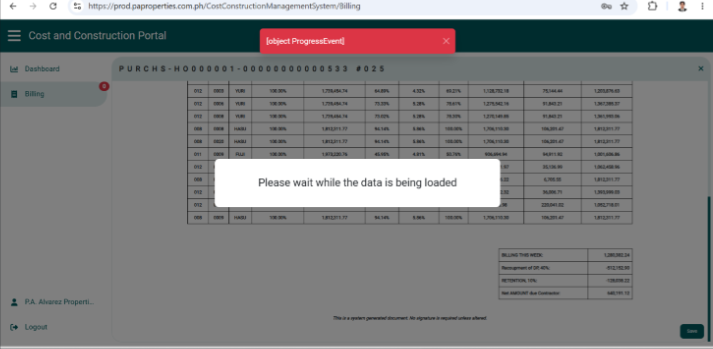

# Common Issues
## Table of Contents
- [Supplier can't find the tag billing](#supplier-cant-find-the-tag-billing)
- [Contractor can't save the progress billing](#contractor-cant-save-the-progress-billing)
- [Document for review not found](#document-for-review-not-found)
---

## Supplier can't find the tag billing
If the contractor can't find the tag billing in **Billgress HouseAccomplishment**, follow the step below.
* Ask the contractor to click the **Add New Billing (+)** button.

## Contractor can't save the progress billing
The contractor may see the following error when saving.

* If the contractor is using another browser, ask them to save the billing in Google Chrome.

## Document for review not found
The PIC may be unable to see the document after the contractor uploads it.
Check the billing record with this query. `SELECT * FROM [COST_CONSTRUCTION].[CCM].[Contractor_Billing] WHERE [PURCHS_NO] LIKE '%1386%'`
* The Current Mock Status must be _Uploaded for PO_.
#### Request a PDF copy of the PO document.
* Go to the data dump and upload the PO document.

Then check whether the document appears in the Document for Review module.
