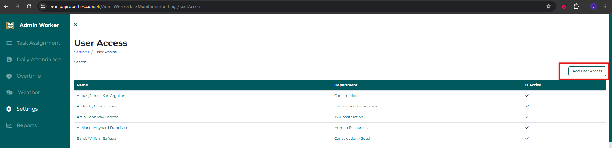
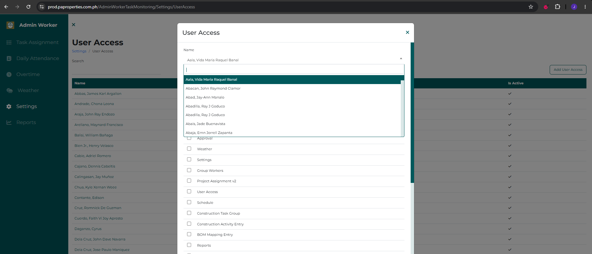
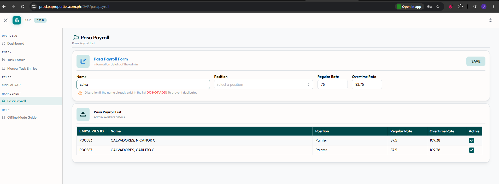
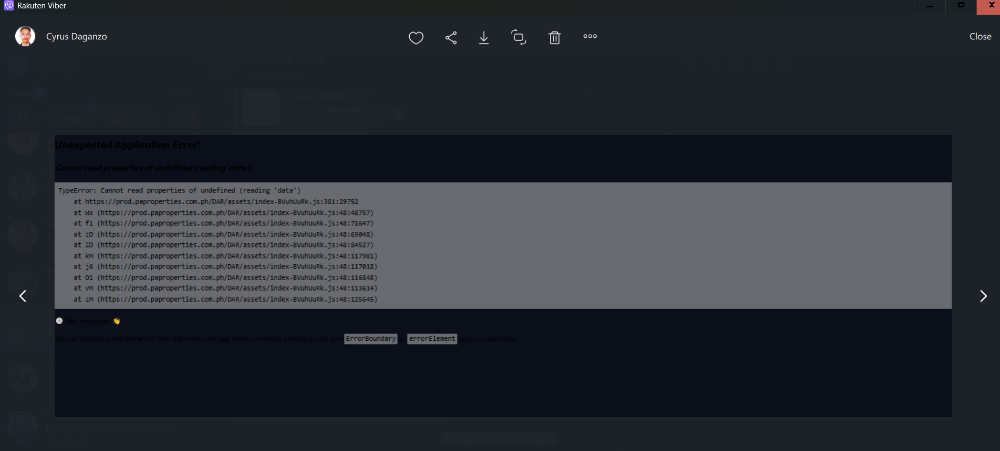

# Common Issues
---
## Table of Contents
- [Granting access](#granting-access)
  - [Create an encoder account](#create-an-encoder-account)
  - [Access to modules](#access-to-modules)
  - [Access to projects](#access-to-projects)
- [Admin Management](#admin-management)
  - [Resync admins](#resync-admins)
  - [Admin is missing](#admin-is-missing)
  - [Unable to assign projects](#unable-to-assign-projects)
  - [Adding new Pasa Payroll admins](#adding-new-pasa-payroll-admins)
- [Setup Activities](#setup-activities)
  - [Duplicate BOM mapping Entry](#duplicate-bom-mapping-entry)
  - [Newly added Activity not appearing](#newly-added-activity-not-appearing)
- [Project Activities Monitoring](#project-activities-monitoring)
  - [User can't select the activity in Task Entry](#user-cant-select-the-activity-in-task-entry)
  - [Completed activity appears incomplete in Project Activities Monitoring](#completed-activity-appears-incomplete-in-project-activities-monitoring)
- [Task Entries](#task-entries)
  - [User can't find the activity](#user-cant-find-the-activity)
  - [Duplicate entries](#duplicate-entries)
  - [Activity is missing from Batch Assignment](#activity-is-missing-from-batch-assignment)

- [Manpower Reporting](#manpower-reporting)
  - [Duplicate rows](#duplicate-rows)
- [Scripts](#scripts)
  - [Migration from LIVE to UAT](#migration-from-live-to-uat)
- [System Crash](#system-crash)

# Granting Access
## Create an encoder account
Use this procedure to grant access to encoders and consultants who are missing from the PA Employee Directory.
Check whether the encoder already exists in `[AWTM].[Setup_White_List_User]`.

If the encoder is missing, fill in the details and run the following script.

    EXEC [AWTM].[NSP_Create_Setup_White_List_User]
     @GENERAL_INFO_ID	= <input an unique value> //get the employee number of the encoder to HR
    ,@USERNAME			  = <input value here> // this will serve as username of the encoder
    ,@FIRSTNAME			  = <input value here>
    ,@MIDDLENAME		  = <input value here>
    ,@LASTNAME			  = <input value here>
    ,@MOBILE_NO			  = <input value here>
    ,@PASSWORD			  = <generate a random password>
    ,@DEPARTMENT			= <input value here>

After running the script, ask for the encoder's personal email address and email them their account details.

## Access to modules
  #### For encoders and consultants, follow [Create an encoder account](#create-an-encoder-account).
  #### For PA/JV, verify that the employee exists in HRIS
  * If the employee is missing, ask for their record to be added to HRIS and wait for it to sync.

  Follow these steps to grant module access.
  1. Open the old version of DAR in [AdminWorkerTaskMonitoring](https://prod.paproperties.com.ph/AdminWorkerTaskMonitoring/Login)
  2. Go to **Settings > User Access**.
  
  3. Click **Add User Access**.
  
  4. Find the account, select the modules the user needs, and click **Save**.
  
  5. After granting access, ask the user to log out and log back in.


  ## Access to Projects
  Verify that the user already has access to at least one module.
  1. In **Settings > User Access**, find the user and click the text highlighted in red.
  
  2. In the dialog, select the projects the user needs to access.
  
  3. Click **Save**
  4. After saving, ask the user to log out and log back in.

  ---
  # Admin Management
  ## Resync admins
  If the admin is missing, you can run the sync manually.
  * Sync administrators from HRIS to DAR by running `EXEC [PA_AWTM].[GL].[SYNC_AdminWorker]`

  ## Admin is missing
  If the admin is missing, check for their record in `[BINITS007\BINITS007SQL].[PAABI_HRIS_Workers].[dbo].[emplinfo]` by querying their name.
  * If the record is missing, ask site HR to add it to Admin HRIS.

  Once HR adds the record, follow the [Resync admins](#resync-admins) procedure.

  ## Unable to assign projects
  If you can't assign new projects to the user, check for an existing assignment.
  * `SELECT * FROM [AWTM].[dbo].[AdminWorkerPhase]` Use this query to find the existing assignment. If it exists, run the following script to set `[IS_ACTIVE]` to 1.

  ```
  DECLARE @EMPSERIESID VARCHAR(80) = '4119' //sample
  DECLARE @PROJECT_CODE VARCHAR(80) = '1020' //sample value you can check the existing project codes at [dbo].[Phase]
  DECLARE @SHOULD_RUN BIT = 0 //0 for debugging and reading. 1 for running the update
  
  SELECT *
  FROM [dbo].[AdminWorkerPhase]
  WHERE [EMPSERIESID] = @EMPSERIESID
  AND [PROJECTCODE] = @PROJECT_CODE
  
  IF @SHOULD_RUN = 0 RETURN // don't update if 0
  
  UPDATE [dbo].[AdminWorkerPhase]
	SET
		[IS_ACTIVE] = 1
  WHERE [EMPSERIESID] = @EMPSERIESID
  AND [PROJECTCODE] = @PROJECT_CODE
  ```

  ## Adding new Pasa Payroll admins
  Follow these steps to add non-PA admins to Pasa Payroll.
  1. Log in to the new version of [DAR](https://prod.paproperties.com.ph/DAR/login)
  2. Go to the Pasa Payroll module
  3. Enter the admin's details.
  
  4. Click **Save**.
  5. Verify that the new admin appears in the list.

  #### Check the list before adding an admin to prevent duplicate records in the report.

  # Setup Activities

  ## Duplicate BOM mapping entry
  When users load or update budgeted man-hours for an activity in Windfield 4 or Windfield 5, the system may fail to set `[IS_ACTIVE]` to *false* for the old record in `ActivityScopeOfWorkLIN`. This can leave duplicate records.
  Use the following script to find and clean up duplicate BOM mapping entries.
  ```
  ;WITH DUPLICATE_BOM AS (
	SELECT 
		*
	FROM  (
		SELECT
			[ID] 
		,	[NOAH_SYSTEM]
		,	[PHASE]
		,	[MODEL]
		,	[LOT_TYPE_PARENT_ID]
		,	[LOT_CODE]
		,	[LOT_DESCRIPTION]
		,	[CONSTRUCTION_ACTIVITY_CODE]
		,	[CREATED_DATE]
		,	ROW_NUMBER() OVER(PARTITION BY 
				[NOAH_SYSTEM]
			,	[PHASE]
			,	[MODEL]
			,	[LOT_TYPE_PARENT_ID]
			,	[LOT_CODE]
			,	[LOT_DESCRIPTION]
			,	[CONSTRUCTION_ACTIVITY_CODE]
			ORDER BY [CREATED_DATE]
		) rn
		FROM  dbo.ActivityScopeOfWorkLIN
		WHERE IS_ACTIVE = 1
		
	)  x
	WHERE 1=1 
	AND PHASE = 'SJWF05'
	AND rn > 1
  )
  
  SELECT * FROM DUPLICATE_BOM
  
  /*UNCOMMENT THIS LINE IF THE CTE DUPLICATE_BOM has return rows*/
  --UPDATE dbo.ActivityScopeOfWorkLIN
  --	SET 
  --		[IS_ACTIVE] = 0
  --WHERE ID IN (SELECT ID FROM DUPLICATE_BOM)
  ```

## Newly added Activity not appearing
A newly added activity may be missing from **BOM Mapping Entry** for either of the following reasons.
* The activity is for other tasks, land development, or post tasks.
* The activity has yet to be tagged to a model unit.

---
# Project Activities Monitoring
## User can't select the activity in Task Entry
Tag the activity as incomplete before selecting it again in **Task Entry**.
1. Open the old version of DAR in [AdminWorkerTaskMonitoring](https://prod.paproperties.com.ph/AdminWorkerTaskMonitoring/Login)
2. Filter by phase and date, then click *Project Activities Monitoring*.

3. Always select a later date in the filter.
4. In Project Activities Monitoring, filter by *Construction Index* and *Blk*.
5. Find the block and lot that the user wants to tag as incomplete.
6. Click **Tag as incomplete**.
7. Try re-encoding the activity.

## Completed activity appears incomplete in Project Activities Monitoring
The user may be unable to select an activity because its accumulated man-hours exceed the budget, even if the activity still appears incomplete in Project Activities Monitoring.
* Ask the user to return to the initial page and select a later date in the filter.
* Ask the user to close the browser and reopen the page in an incognito window.

#### Run the following script to check whether the activity has exceeded its budgeted man-hours

```
DECLARE @TaskCode VARCHAR(20) = ''
DECLARE @Blk VARCHAR(20) = ''
DECLARE @Lot VARCHAR(20) = ''

SELECT 
	hdr.[PhaseCode]
,	hdr.[AdminWorker]
,	CONCAT(x.LastName, ', ', x.[FirstName]) Name
,	lin.[Blk]
,	lin.[Lot]
,	lin.[TaskCode]
,	lin.[TaskDescription]
,	lin.[DateTimeIn]
,	lin.[DateTimeOut]
,	dbo.[FNS_GetRegularWorkingHours](lin.[DateTimeIn], lin.[DateTimeOut], 1) total_hours
FROM [dbo].[TaskAssignmentSummaryHDR] hdr
JOIN [dbo].[TaskAssignmentSummaryLIN] lin
ON hdr.[Code] = lin.[Code]
OUTER APPLY (
	SELECT 
		*
	FROM AdminWorker WHERE EMPSERIESID = hdr.[AdminWorker]
) x
WHERE lin.[TaskCode] = @TaskCode  AND lin.[Blk] = @Blk AND lin.[Lot] = @Lot
```

---

# Task Entries

## User can't find the activity
The activity the encoder wants to enter has no allocated man-hours.
* Ask the Cost Department to set up the activity and enter the budgeted man-hours.

## Duplicate entries
Encoders may report duplicate entries.
* Find the reported entries in `[PA_AWTM].[dbo].[TaskAssignmentSummaryLIN]` and compare their `RN` values. Different values indicate separate entries. Ask the encoder to delete the entry they added by mistake.

## Activity is missing from Batch Assignment
Activities may fail to load when the user changes the Construction Index filter in Batch Assignment.
* Ask the user to close and reopen the Batch Assignment dialog, reapply the filters, and wait for the activity to load.

---

# Manpower Reporting
Check the manpower report at [Manpower Reporting MonitoringV2](http://secure.pagroup.com.ph/Reports_PAGROUPSQL/Pages/Report.aspx?ItemPath=%2fDAR%2fManpower+MonitoringV2)
## Duplicate rows
This issue affects projects that use Pasa Payroll. It can occur when the PIC or encoder uses a Pasa Payroll record for an admin who already has an HRIS record.
* Find the admin in `[BINITS007\BINITS007SQL].[PAABI_HRIS_Workers].[dbo].[emplinfo]` and check `[EMPLOYEESTATUS]`. A value of `S` indicates that the admin has resigned from the role recorded in HRIS. In Project Assignment, remove the old assignment and assign the equivalent Pasa Payroll record using its Empseriesid. Reverse the process if the HRIS record is the one that should be assigned.

---

# Scripts
## Migration from LIVE to UAT
To reproduce an issue, copy the data from LIVE (SPDITS016) to DEV (SPDITS005-B).

#### Verify that you are connected to SPDITS005-B before running these scripts

To copy the task header records, use `[TasksHDR_prod_to_dev.sql]`
```
BEGIN TRANSACTION

TRUNCATE TABLE [dbo].[TaskAssignmentSummaryHDR] 

INSERT INTO [dbo].[TaskAssignmentSummaryHDR] (
	[Code]
,	[AdminWorker]
,	[HRISSystem]
,	[NoahSystem]
,	[PhaseCode]
,	[DateTimeIn]
,	[Status]
,	[IsActive]
,	[RecUser]
,	[RecDate]
,	[ModelCode]
,	[IsEarlyOut]
,	[EarlyOutReason]
)
SELECT 
		[Code]
,	[AdminWorker]
,	[HRISSystem]
,	[NoahSystem]
,	[PhaseCode]
,	[DateTimeIn]
,	[Status]
,	[IsActive]
,	[RecUser]
,	[RecDate]
,	[ModelCode]
,	[IsEarlyOut]
,	[EarlyOutReason]
FROM [SPDITS016].[PA_AWTM].[dbo].[TaskAssignmentSummaryHDR] WHERE RecDate >= '2025-03-04'

Select * from [dbo].[TaskAssignmentSummaryHDR]

ROLLBACK TRANSACTION
```

Use the following script to copy task line records from LIVE to DEV.
```

BEGIN TRANSACTION

TRUNCATE TABLE [dbo].[TaskAssignmentSummaryLIN] 

SET IDENTITY_INSERT [dbo].[TaskAssignmentSummaryLIN] on;

INSERT INTO [dbo].[TaskAssignmentSummaryLIN] (
	[Code]
,	[Category]
,	[Blk]
,	[Lot]
,	[TaskCode]
,	[TaskDescription]
,	[DateTimeIn]
,	[DateTimeOut]
,	[IsOT]
,	[OTBatchID]
,	[IsActive]
,	[RecUser]
,	[RecDate]
,	[RN]
,	[IsNew]
,	[IsEnd]
,	[ProjectedTimeOut]
,	[JustificationForOT]
,	[UploadedCode]
)
SELECT 
		[Code]
,	[Category]
,	[Blk]
,	[Lot]
,	[TaskCode]
,	[TaskDescription]
,	[DateTimeIn]
,	[DateTimeOut]
,	[IsOT]
,	[OTBatchID]
,	[IsActive]
,	[RecUser]
,	[RecDate]
,	[RN]
,	[IsNew]
,	[IsEnd]
,	[ProjectedTimeOut]
,	[JustificationForOT]
,	[UploadedCode]
FROM [SPDITS016].[PA_AWTM].[dbo].[TaskAssignmentSummaryLIN] WHERE RecDate >= '2025-03-04'


SET IDENTITY_INSERT [dbo].[TaskAssignmentSummaryLIN] off;

select * from [dbo].[TaskAssignmentSummaryLIN] 

rollback TRANSACTION
```

After verifying the results and confirming that you are connected to SPDITS005-B, change `ROLLBACK TRANSACTION` to `COMMIT TRANSACTION`.

---

# System Crash
The user may see the following error when the system crashes.

* Ask the user to open DAR in an incognito window.
