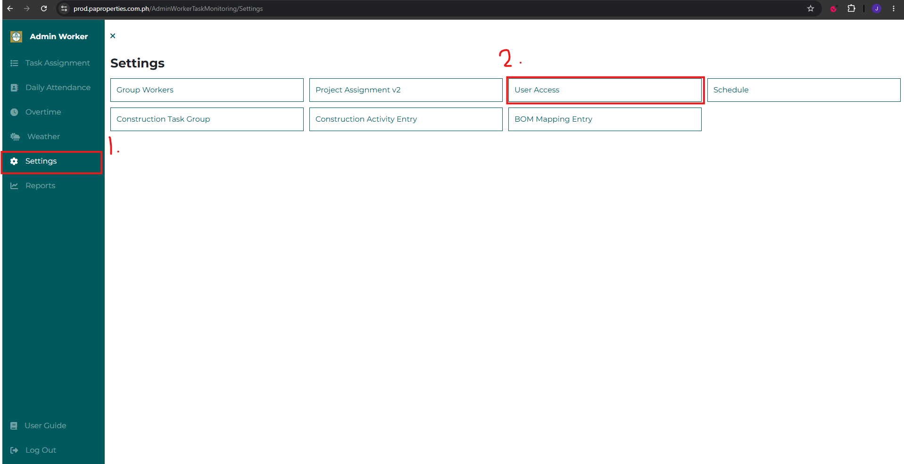
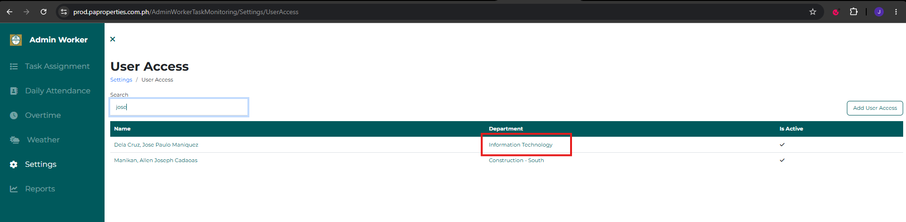
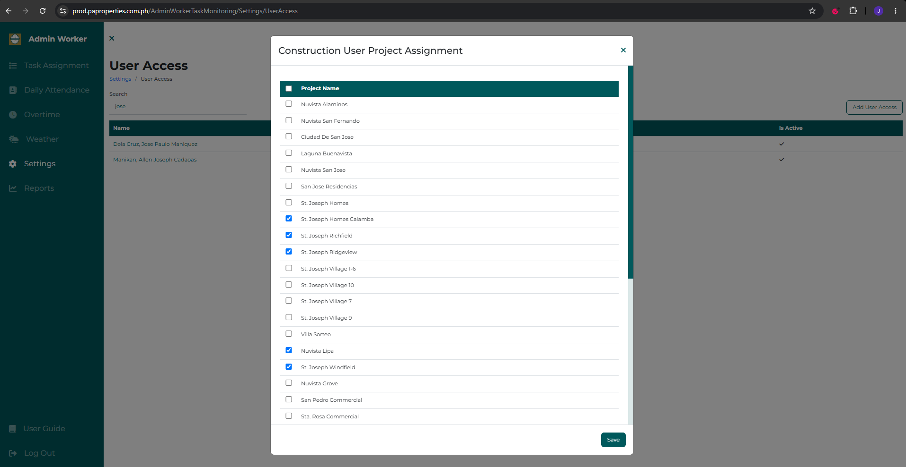
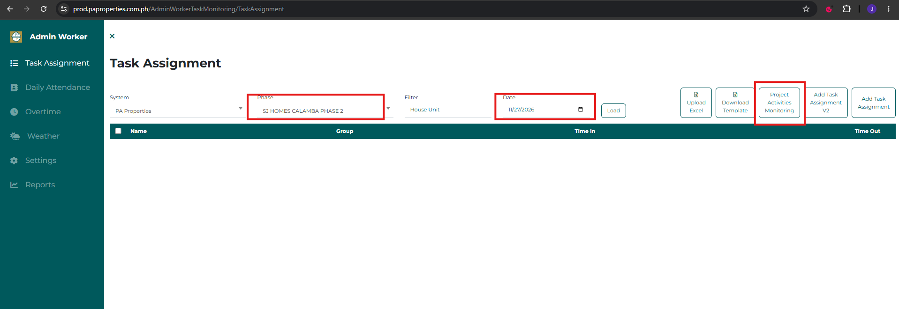

# Common Issues
---
## Table of Contents
- [Granting access](#granting-access)
  - [Create Encoder Account](#create-encoder-account)
  - [Access to modules](#access-to-modules)
  - [Access to projects](#access-to-projects)
- [Admin Management](#admin-management)
  - [Resynch admins](#resynch-admins) 
  - [Admin can not be found](#admin-can-not-be-found)
  - [Unable to assign projects](#unable-to-assign-projects)
  - [Adding new Pasa Payroll admins](#adding-new-pasa-payroll-admins)
- [Setup Activities](#setup-activities)
  - [Duplicate BOM mapping Entry](#duplicate-bom-mapping-entry)
  - [Newly added Activity not appearing](#newly-added-activity-not-appearing)
- [Project Activities Monitoring](#project-activities-monitoring)
  - [User cant select the activity from task entry](#user-cant-select-activity-from-task-entry)
  - [Activity is already completed but in the project activity monitoring not yet](#activity-is-already-completed-but-in-the-project-activity-not-yet)
- [Task Entries](#task-entries)
  - [User cant find the activity](#user-cant-find-the-activity)
  - [Duplicate entries](#duplicate-entries)
  - [Batch Assigning activity not appearing](#batch-assigning-acitivty-not-appearing)
  - [Overtime until early morning](#overtime-until-early-morning)
- [Manpower Reporting](#manpower-reporting)
  - [Duplicate rows](#duplicate-rows)
- [Scripts](#scripts)
  - [Migration from LIVE to UAT](#migration-from-live-to-uat)
- [System Crash]

# Granting Access
## Create Encoder DAR V2
For encoder & Consultants that doesn't exists in the PA Employee Directory. Granting access to them.
You can check if the encoder already exists to this table `[AWTM].[Setup_White_List_User]`.

IF NOT! run this script and filled out the details 

    EXEC [AWTM].[NSP_Create_Setup_White_List_User]
     @GENERAL_INFO_ID	= <input an unique value> //get the employee number of the encoder to HR
    ,@USERNAME			  = <input value here> // this will serve as username of the encoder
    ,@FIRSTNAME			  = <input value here>
    ,@MIDDLENAME		  = <input value here>
    ,@LASTNAME			  = <input value here>
    ,@MOBILE_NO			  = <input value here>
    ,@PASSWORD			  = <generate a random password>
    ,@DEPARTMENT			= <input value here>

once run, request the personal email of the encoder's and send it to them via email. 

## Access to modules
  #### For Encoder accounts & consultants-Implement this step [Create Encoder Account](#create-encoder-account).
  #### For PA/JV - make sure the employee already exists in the HRIS
  * Request to have them encoded to the HRIS and wait for it be synced

  for granting access to any modules.
  1. Open the link old version of the DAR [AdminWorkerTaskMonitoring](https://prod.paproperties.com.ph/AdminWorkerTaskMonitoring/Login)
  2. Go to the Settings>User Access
  
  3. Click the button **Add User Access**
  
  4. Search for the account & tick any modules he/she needs then Click **Save**
  
  5. Once granted request the user to logout and relogin his/her account.


  ## Access to Projects
  Make sure they have an existing module access to any. 
  1. From the Settings\User Access. Search the name of the user and click the red highlighted text
  
  2. You will see a Pop-up dialog. Tick the projects they want access
  
  3. Click **Save**
  4. Once saved request the user to logout and relogin his/her account.

  ---
  # Admin Management
  ## Resynch admins
  Most cases if they don't see the admin. You can run the synching manually
  * Sync admins from HRIS to DAR by simply running this Store procedure `EXEC [PA_AWTM].[GL].[SYNC_AdminWorker]`

  ## Admin can not be found
  Most cases if the admin can not be found. The admin is not yet encoded from `[BINITS007\BINITS007SQL].[PAABI_HRIS_Workers].[dbo].[emplinfo]`. To verify query the name and check if it's exists
  * if not request to the site hr to have them recorded in the Admin HRIS systems

  once done implement [Resynch admins](#resynch-admins)

  ## Unable to assign projects
  if the user can't be assign new projects. 
  * `SELECT * FROM [AWTM].[dbo].[AdminWorkerPhase]` Check in this table if it has already existing setup. if yes run this script and update the `[IS_ACTIVE]` column to 1

  ```
  DECLARE @EMPSERIESID VARCHAR(80) = '4119' //sample
  DECLARE @PROJECT_CODE VARCHAR(80) = '1020' //sample value you can check the existing project codes at [dbo].[Phase]
  DECLARE @SHOULD_RUN BIT = 0 //0 for debugging and reading. 1 for running the update
  
  SELECT *
  FROM [dbo].[AdminWorkerPhase]
  WHERE [EMPSERIESID] = @EMPSERIESID
  AND [PROJECTCODE] = @PROJECT_CODE
  
  IF @SHOULD_RUN = 0 RETURN // don't update if 0
  
  UPDATE [dbo].[AdminWorkerPhase]
	SET
		[IS_ACTIVE] = 1
  WHERE [EMPSERIESID] = @EMPSERIESID
  AND [PROJECTCODE] = @PROJECT_CODE
  ```

  ## Adding new Pasa Payroll admins
  for assigning non PA admins pasa payroll.
  1. Login to the new version of [DAR](https://prod.paproperties.com.ph/DAR/login)
  2. Go to the Pasa Payroll module
  3. Input the details of the admin 
  
  4. Click Save
  5. It will appear in the list the new added admin

  #### Take note if the name of the admin already exists in the list. refrain from adding it to the record. To avoid duplicate admin records to the report.

  ## Duplicate BOM mapping Entry
  some cases when they try to load e.g `Windfield 4 or Windfield 5` when loading or updating a new Budget Manhours to an activity. it will failed updating the old from the table `ActivityScopeOfWorkLIN` column `[IS_ACTIVE]`  to *false*. You will see double records. 
  I 've created a clean up script for duplicate BOM Mapping Entry
  ```
  ;WITH DUPLICATE_BOM AS (
	SELECT 
		*
	FROM  (
		SELECT
			[ID] 
		,	[NOAH_SYSTEM]
		,	[PHASE]
		,	[MODEL]
		,	[LOT_TYPE_PARENT_ID]
		,	[LOT_CODE]
		,	[LOT_DESCRIPTION]
		,	[CONSTRUCTION_ACTIVITY_CODE]
		,	[CREATED_DATE]
		,	ROW_NUMBER() OVER(PARTITION BY 
				[NOAH_SYSTEM]
			,	[PHASE]
			,	[MODEL]
			,	[LOT_TYPE_PARENT_ID]
			,	[LOT_CODE]
			,	[LOT_DESCRIPTION]
			,	[CONSTRUCTION_ACTIVITY_CODE]
			ORDER BY [CREATED_DATE]
		) rn
		FROM  dbo.ActivityScopeOfWorkLIN
		WHERE IS_ACTIVE = 1
		
	)  x
	WHERE 1=1 
	AND PHASE = 'SJWF05'
	AND rn > 1
  )
  
  SELECT * FROM DUPLICATE_BOM
  
  /*UNCOMMENT THIS LINE IF THE CTE DUPLICATE_BOM has return rows*/
  --UPDATE dbo.ActivityScopeOfWorkLIN
  --	SET 
  --		[IS_ACTIVE] = 0
  --WHERE ID IN (SELECT ID FROM DUPLICATE_BOM)
  ```

## Newly added Activity not appearing
Some cases the user is not aware why the newly added activity is not showing in the **BOM Mapping Entry** module.
* The activty is for other tasks/land dev/post task.
* The activity is not yet tag to a model unit.

---
# Project Activities Monitoring
## User cant select the activity from task entry
User is not aware that they need to tag the activity as imcomplete for it to be selected again from the **Task Entry**
1. Go to old version of DAR [AdminWorkerTaskMonitoring](https://prod.paproperties.com.ph/AdminWorkerTaskMonitoring/Login)
2. Filter the Phase and Date then click *Project Activities Monitoring*

3. Always filter the date ahead.
4. From Project Activities Monitoring filter the *Construction Index* & *Blk*
5. Search which blk & lot the user wants to tag as incomplete.
6. Click Tag as incomplete
7. Try re-encoding the activity.

## Activity is already completed but in the project activity monitoring not yet
User can't select a certain activity due to it is already exceed on the Accumulated Manhours however upon checking in the Project Activities Monitoring not yet.
* Ask the user to go back from the initial page and filter the date ahead.
* Ask the user to close the broswer and open it via incognito.

#### For Tracing you can run this script and validate if it's already exceed from it's budget manhours

```
DECLARE @TaskCode VARCHAR(20) = ''
DECLARE @Blk VARCHAR(20) = ''
DECLARE @Lot VARCHAR(20) = ''

SELECT 
	hdr.[PhaseCode]
,	hdr.[AdminWorker]
,	CONCAT(x.LastName, ', ', x.[FirstName]) Name
,	lin.[Blk]
,	lin.[Lot]
,	lin.[TaskCode]
,	lin.[TaskDescription]
,	lin.[DateTimeIn]
,	lin.[DateTimeOut]
,	dbo.[FNS_GetRegularWorkingHours](lin.[DateTimeIn], lin.[DateTimeOut], 1) total_hours
FROM [dbo].[TaskAssignmentSummaryHDR] hdr
JOIN [dbo].[TaskAssignmentSummaryLIN] lin
ON hdr.[Code] = lin.[Code]
OUTER APPLY (
	SELECT 
		*
	FROM AdminWorker WHERE EMPSERIESID = hdr.[AdminWorker]
) x
WHERE lin.[TaskCode] = @TaskCode  AND lin.[Blk] = @Blk AND lin.[Lot] = @Lot
```

---

## User cant find the activity
Encododer isn't aware that the current activity he/she want to encode don't have budget manhours allocated.
* Kindly ask the cost department to setup the activity to input the allocated budget manhours

## Duplicate entries
Encoder will report that they will experience duplication of entries. 
* Query the duplicate entry in this table `[PA_AWTM].[dbo].[TaskAssignmentSummaryLIN]` that they reported and look for the column `RN` is the value is different. **IT IS NOT DUPLICATE ENTRIES** it's an error on their part. Kindly ask them to delete it on their end.

## Batch Assigning activity not appearing
When batch assigning some instances it will failed from loading when filtering different Construction Index. if that's happens
* Ask the user the close the Batch Assignment Pop up and click it again. Filter the details and wait for the activity to load.

---

# Manpower Reporting
Check the manpower report at [Manpower Reporting MonitoringV2](http://secure.pagroup.com.ph/Reports_PAGROUPSQL/Pages/Report.aspx?ItemPath=%2fDAR%2fManpower+MonitoringV2)
## Duplicate rows
This only affect with projeect that has PasaPayroll. Most cases this occurs due to the PIC/Encoder is not aware. The admin is already encoded in the HRIS insist that they are for PasaPayroll.
* Solution is to verify if the HRIS record is still active `[BINITS007\BINITS007SQL].[PAABI_HRIS_Workers].[dbo].[emplinfo]` query the admin and check if the column `[EMPLOYEESTATUS]` if `S` meaning resign. use the PasaPayroll Empseriesid. Go to the Project Assignment and look for the old Admin Name and unassign the admin to the project & assign the pasapayroll equivalent to the project. *Vice Versa*

---

# Scripts
## Migration from LIVE to UAT
For recreating issues. Recommended is that you copy the data from live (SPDITS016) to Dev(SPDITS005-B)

#### Make sure you ore cunrrently at SPDITS005-B server to run this scripts

For copying the Header `[TasksHDR_prod_to_dev.sql]`
```
BEGIN TRANSACTION

TRUNCATE TABLE [dbo].[TaskAssignmentSummaryHDR] 

INSERT INTO [dbo].[TaskAssignmentSummaryHDR] (
	[Code]
,	[AdminWorker]
,	[HRISSystem]
,	[NoahSystem]
,	[PhaseCode]
,	[DateTimeIn]
,	[Status]
,	[IsActive]
,	[RecUser]
,	[RecDate]
,	[ModelCode]
,	[IsEarlyOut]
,	[EarlyOutReason]
)
SELECT 
		[Code]
,	[AdminWorker]
,	[HRISSystem]
,	[NoahSystem]
,	[PhaseCode]
,	[DateTimeIn]
,	[Status]
,	[IsActive]
,	[RecUser]
,	[RecDate]
,	[ModelCode]
,	[IsEarlyOut]
,	[EarlyOutReason]
FROM [SPDITS016].[PA_AWTM].[dbo].[TaskAssignmentSummaryHDR] WHERE RecDate >= '2025-03-04'

Select * from [dbo].[TaskAssignmentSummaryHDR]

ROLLBACK TRANSACTION
```

For copying the Task Lin LIVE to DEV
```

BEGIN TRANSACTION

TRUNCATE TABLE [dbo].[TaskAssignmentSummaryLIN] 

SET IDENTITY_INSERT [dbo].[TaskAssignmentSummaryLIN] on;

INSERT INTO [dbo].[TaskAssignmentSummaryLIN] (
	[Code]
,	[Category]
,	[Blk]
,	[Lot]
,	[TaskCode]
,	[TaskDescription]
,	[DateTimeIn]
,	[DateTimeOut]
,	[IsOT]
,	[OTBatchID]
,	[IsActive]
,	[RecUser]
,	[RecDate]
,	[RN]
,	[IsNew]
,	[IsEnd]
,	[ProjectedTimeOut]
,	[JustificationForOT]
,	[UploadedCode]
)
SELECT 
		[Code]
,	[Category]
,	[Blk]
,	[Lot]
,	[TaskCode]
,	[TaskDescription]
,	[DateTimeIn]
,	[DateTimeOut]
,	[IsOT]
,	[OTBatchID]
,	[IsActive]
,	[RecUser]
,	[RecDate]
,	[RN]
,	[IsNew]
,	[IsEnd]
,	[ProjectedTimeOut]
,	[JustificationForOT]
,	[UploadedCode]
FROM [SPDITS016].[PA_AWTM].[dbo].[TaskAssignmentSummaryLIN] WHERE RecDate >= '2025-03-04'


SET IDENTITY_INSERT [dbo].[TaskAssignmentSummaryLIN] off;

select * from [dbo].[TaskAssignmentSummaryLIN] 

rollback TRANSACTION
```

just change to line `ROLLBACK TRANSACTION` into `COMMIT TRANSACTION` if **CONFIDENT** and sure that you are currently at SPDITS005-B

---

# System Crash
If user encounter system crash. like this.

* Request the user to use incognito. This resolves the issue.
