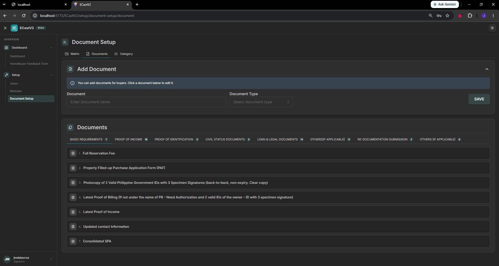
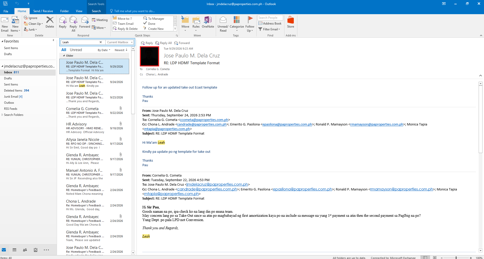

# Common Issues

## Table of Contents
- [IMPORTANT REMINDER BEFORE SENDING!](#important-reminder-before-sending!)
- [Hi Plus notification](#hi-plus-notification) 
- [House & Bank Financing](#house-&-bank-financing)
- [House Financing Renewal of Document](#house-financing-renewal-of-document)
- [Kwentong Buhay](#kwentong-buhay)
  - [Kwentong Buhay for PA](#kwentong-buhay-for-pa)
  - [Kwentong Buhay for JV](#kwentong-buhay-for-JV)
- [Home Buyer Feedback Form](#home-buyer-feedback-form)
  - [Reservation](#reservation)
  - [Loan Processing](#loan-processing)
  - [Turnover](#turnover)
- [Conversion](#conversion)
  - [Converted Title](#converted-title)
  - [Account Stage Status](#account-stage-status)
  - [Document Compliance](#document-compliance)
- [Bank Financing](#bank-financing)
- [LPD](#lpd)
- [CCDC](#ccdc)
- [CCNC Payment Reminder for PA & JV](#ccnc-payment-reminder-for-pa-&-jv)

---

# IMPORTANT REMINDER BEFORE SENDING!
Before sending any ecast to buyers.
1. For testing send it to your self first!
2. Validate the data. Request for approval to the requestor.
3. Send to the requestor have him/her to proof read the content.
4. always check the length of the SMS at [SMS Cost Tracker](https://www.smsgatewaycenter.com/sms-length-calculator/) 1 sms cost PHP1.00. if the length of the SMS contains to much text. Ask the requestor to shorten the length of the message.

# Hi Plus notification
Database location `ECast_Prod`
* `[dbo].[JOBS_NSP_SYNC_Send_HomeInfoBuyersPromotion]` // For sending to PA/JV Buyers

## House & Bank Financing
Database location `ECast_Prod`      
SSRS Link: [House & Bank Financing Report](http://secure.pagroup.com.ph/Reports_PAGROUPSQL/Pages/Report.aspx?ItemPath=%2fUAT%2fEcast%2fEcastJvAccounts).    

#### Scripts   
* `[dbo].[NSP_Sync_Idesia_AccountsJV]`  //Collection Datasource
* `[dbo].[NSP_SEND_NOTIF_TO_IDESIA_ACCOUNTS] ` //scheduled sending Ecast Outsystem Weekly every monday
* `[dbo].[IDESIA_ACCOUNTS_HISTORY]`  // datasource for the report

## House Financing Renewal of Document
Database location `ECast_prod`    
SSRS Link: [House Financing Renewal of Document](http://secure.pagroup.com.ph/Reports_PAGROUPSQL/Pages/Report.aspx?ItemPath=%2fUAT%2fEcast%2fHouseFinancingReport)

#### Scripts
`[dbo].[NSP_HouseFinancingRenewalDocumentReport]` //datasource of the report
`[dbo].[JOBS_NSP_SYNC_CSTMR_LEDGER]` // syching runs of every June 1st & Dec 1st and sending

## Kwentong Buhay
A Script to run the promotion of Kwentong Buhay Goals

### Kwentong Buhay for PA
```

IF OBJECT_ID('tempdb..#PA_buyers') IS NOT NULL
DROP TABLE #PA_buyers

SELECT 
	[BUYERS_NAME] 
,	[MOBILE_NO] 
INTO #PA_buyers
FROM [DataSource].[Buyers_Information]
WHERE [BUYERS_STATUS] NOT IN ('CANCELLED')
AND [IS_TAKEN_OUT] = 0 AND [IS_FULLY_PAID] = 0
AND [SYSTEM] = 'NOAH_PAAPDC'
AND [MOBILE_NO] IS NOT NULL

DECLARE @SMS_MESSAGE NVARCHAR(MAX) = <INPUT MESSAGE HERE>

--INSERT INTO [ECast].[SMS_Queue]
--	(JOBS_ID, MESSAGE, MOBILE_NO, MASK_NAME) /*UNCOMMENT THIS LINE TO TRIGGER SENDING*/
select 
	32
,	@SMS_MESSAGE
,	[MOBILE_NO] 
,	'PA Properties' [MASKNAME]
FROM #PA_buyers


DROP TABLE #PA_buyers -- clean table
```

### Kwentong Buhay for JV
```

DECLARE @JOBS_ID INT = 38

IF OBJECT_ID('tempdb..#JV_buyers') IS NOT NULL
DROP TABLE #JV_buyers

SELECT 
	[BUYERS_NAME] 
,	[MOBILE_NO] 
INTO #JV_buyers
FROM [DataSource].[Buyers_Information]
WHERE [BUYERS_STATUS] NOT IN ('CANCELLED')
AND [IS_TAKEN_OUT] = 0 AND [IS_FULLY_PAID] = 0
AND [SYSTEM] NOT IN (
	'NOAH_PHVECTORONE_COMMERCIAL'
,	'NOAH_PAMRBI'
,	'NOAH_PAAPVI'
,	'NOAH_PHVECTORONE_HEIGHTS'
,	'NOAH_PHVECTORONE'
,	'NOAH_PAAPDC'
)	
AND [MOBILE_NO] IS NOT NULL

DECLARE @SMS_MESSAGE NVARCHAR(MAX) = <INPUT MESSAGE HERE>


--INSERT INTO [ECast].[SMS_Queue]
--	(JOBS_ID, MESSAGE, MOBILE_NO, MASK_NAME) /*uncomment this line to trigger sending*/
select 
	@JOBS_ID
,	@SMS_MESSAGE
,	[MOBILE_NO] 
,	'Idesia' [MASKNAME]
FROM #JV_buyers

DROP TABLE #JV_buyers
```

## Home Buyer Feedback Form

### Reservation
Database location `[Ecast]` table `Ecast_Recipients_Loan_Processing`    
SSRS Link: [Reservation Report](http://spdits016/Reports_PAGROUPSQL/Pages/Report.aspx?ItemPath=%2fECast%2fEcastHomeBuyerForm%2fReservation)

#### Scripts
* `[HFF].[NSP_Jobs_Synching_Reservation_V2]` // Runs every 11AM daily sending
* `[HFF].[Ecast_Recipients_Reservation]` // Data source for Sending Ecast
* `[HFF].[Ecast_Recipients_Reservation_History]` // Data source for Report 
* `[HFF].[Response_Reservation]` // Answered Survey results 

### Loan Processing
Database location `[Ecast]` table `Ecast_Recipients_Loan_Processing`    
SSRS Link: [Loan Proccessing Report](http://spdits016/Reports_PAGROUPSQL/Pages/Report.aspx?ItemPath=%2fECast%2fEcastHomeBuyerForm%2fLoanProcessing)

#### Scripts
* `EXEC [HFF].[NSP_Jobs_SYnching_Loan_Processing_V2]` // Jobs synching runs every 11AM daily sending
* `[HFF].[Ecast_Recipients_Loan_Processing]` // data source for sending
* `[HFF].[Ecast_Recipients_Loan_Processing_History]` // datasource for report
* `[ECAST].[HFF].[Response_Loan_Takeout]` // Answered Survey results

## Turnover
Database location `[Ecast]` table `[HFF].[Ecast_Recipients_Turnover]`    
SSRS LINK: [Turnover Report](http://spdits016/Reports_PAGROUPSQL/Pages/Report.aspx?ItemPath=%2fECast%2fEcastHomeBuyerForm%2fTurnover)

#### Scripts
* `[HFF].[NSP_Jobs_Synching_Turnover_V2]` // Jobs synching runs every 11AM daily sending
* `[HFF].[Ecast_Recipients_Turnover]` // Datasource for sending
* `[HFF].[Ecast_Recipients_Turnover_History]` // Datasource for reports 
* `[HFF].[Response_Turnover]` //Answered Surveys results


# Conversion 
## Converted Title
Database location `[Ecast]` table `[ECAST_Receipient_AccountStage_ConvertedTitle_History]`
SSRS Link: [Converted Title Report](http://spdits016/Reports_PAGROUPSQL/Pages/Report.aspx?ItemPath=%2fECast%2fConversion+Account+Stage%2fConvertedTitle)

#### Scripts
*  `[CONV].[NSP_Conversion_ConvertedTitle_Synch]` // Job synching runs every day 10AM
*  `[CONV].[NSP_Conversion_ConvertedTitle_Sending]` // Jobs for Sending 
*  `[CONV].[ECAST_Receipient_AccountStage_ConvertedTitle]` // datasource for sending
*  `[CONV].[ECAST_Receipient_AccountStage_ConvertedTitle_History]` // datasource for report

## Account Stage Status
Database location `[Ecast]` table `[ECAST_Receipient_AccountStage_Status]`  
SSRS Link: [Account Status](http://spdits016/Reports_PAGROUPSQL/Pages/Report.aspx?ItemPath=%2fECast%2fConversion+Account+Stage%2fCCDC_Account_Status)

#### Scripts
* `[CONV].[NSP_Conversion_Account_Stage_Synch]` // Job synching runs every day 10AM
* `[CONV].[NSP_Conversion_Account_Stage_Sending]` // Job for sending
* `[CONV].[ECAST_Receipient_AccountStage_Status]` // datasource for sending
* `[CONV].[ECAST_Receipient_AccountStage_Status_History]` // datasource for report

## Document Compliance
Database location `[Ecast]` from `[CONV].[ECAST_Receipient_AccountStage_Document_Compliance_History]`   
SSRS Link: [Document Compliance Report](http://spdits016/Reports_PAGROUPSQL/Pages/Report.aspx?ItemPath=%2fECast%2fConversion+Account+Stage%2fDocumentCompliance)

#### Scripts
* `[CONV].[NSP_Conversion_Document_Compliance_Synch]` // Job synching run every day 10AM
* `[CONV].[NSP_Conversion_Document_Compliance_Sending]` // Job for sending
* `[CONV].[ECAST_Receipient_AccountStage_Document_Compliance]` // Datasource for sending 
* `[CONV].[ECAST_Receipient_AccountStage_Document_Compliance_History]` // Datasource for report

## Bank Finacing 
#### Note: It only run once and put on hold due to the inconsistent tag in the remarks section. Due to that reason this system is created. A checklist for each buyer.


Database location `[Ecast]` from `[ECast].[BANK_FINANCING]`     
SSRS Link: [Bank Financing Report](http://spdits016/Reports_PAGROUPSQL/Pages/Report.aspx?ItemPath=%2fECast%2fConversion+Account+Stage%2fBankFinancing)

#### Scripts
* `[NSP_BankFinancing_JOBS_Synching]` // Job Stop
* `[ECast].[NSP_Bank_Financing_List]` // Datasource for report
* `[ECast].[BANK_FINANCING]` // Datasource for Sending

## LPD 
#### This is already done however from the side of LPD. Is still pending to update the template they gave.

This is the recent email sent.

Database location `[ECast]` table `[dbo].[Ecast_Recipient_Initiative]`  
SSRS Link: [LPD Report Initiative](http://spdits016/Reports_PAGROUPSQL/Pages/Report.aspx?ItemPath=%2fECast%2fConversion+Account+Stage%2fLDP_Initiative)

#### Scripts
* `[LDP].[NSP_LDP_HDMF_Initiative_Synching]` // Not currently running job
* `[NSP_LDP_Initiative_List]` // Datasource for report.

Ecast script for sending with template done.
Check it at [LPD Initiative Sending scipt](./scripts/LDPHDMFSendingScript.sql) 
Just update the template and setup the job.

## CCDC
Database Location `[ECast]` table `[Account_Stage_Status]`    
SSRS Link: [CCDC Account Status](http://spdits016/Reports_PAGROUPSQL/Pages/Report.aspx?ItemPath=%2fECast%2fConversion+Account+Stage%2fCCDC_Account_Status)

#### Scripts
 * [CCDC Account Status Update](./scripts/ECastCCDCAccounts.sql) // not currently running.
 * [CCDC Account Status sending](./scripts/ECastCCDCSending.sql) // sending script
#### The script are already validated by Ma'am Glenda. Just update the template if she request for a change.

## CCNC Payment Reminder for PA & JV
#### Pending on the side of CNC Janica for validation due to CONSO aging report.
#### on JV side pending

Database location `[Ecast]` table `CNC.[ReminderDueAccounts]`   
SSRS Link: [CNC Payment Reminder for PA|JV](http://secure.pagroup.com.ph/Reports_PAGROUPSQL/Pages/Report.aspx?ItemPath=%2fECast%2fConversion+Account+Stage%2fCNC+Payment+Reminder)

#### Scripts
* [CNCPaymentReminderPAJV](./scripts/CNCPaymentReminderPAJV.sql) // Script for gathering buyers that has Past dues
