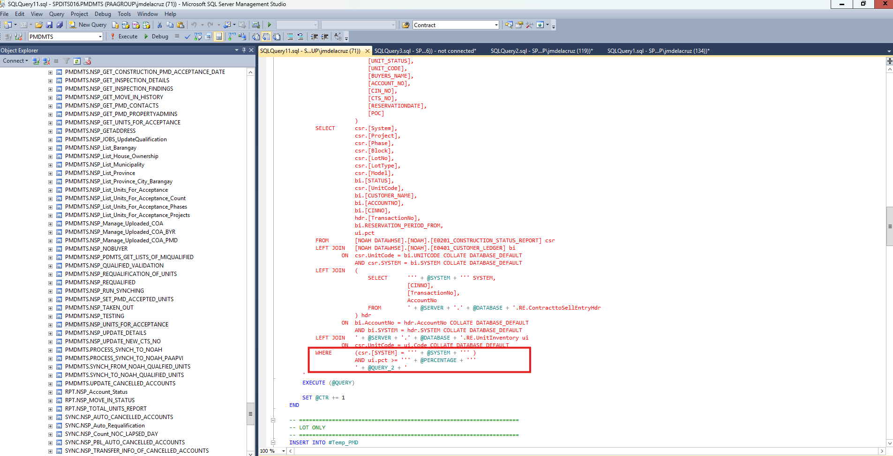

# Common Issues
---
## Table of Contents
- [Debugging](#debugging)
  - [Trace issues in outsystem](#Trace-issue-in-outsystem)
- [Granting Access](#granting-access)
  - [LDAP](#ldap)
  - [Module Access](#module-access)
- [Unit Acceptance](#unit-acceptance)
  - [Unit not appearing for unit acceptance](#unit-not-appearing-for-unit-acceptance)
  - [Unit incomplete checklist](#unit-incomplete-checklist)
  - [Update COA date](#update-coa-date)
  - [Buyer Details is not updated](#buyer-details-is-not-updated)
- [PMD Accepted Units](#pmd-accepted-units)
  - [For Regular MoveIn](#for-regular-movein)
    - [Unit not appearing for Regular MoveIn](#unit-not-appearing-for-regular-movein)
  - [For Early MoveIn](#for-early-movein)
    - [User expect the unit is for early MoveIn](#user-expect-the-unit-is-for-early-movein)
  - [NQ-For Early MoveIn](#nq-for-early-movein)
    - [Cant process unit back to Qualified for Turnover](#cant-process-unit-back-to-qualified-for-turnover)

---

# Debugging
## Trace issues in outsystem
Useful when new concerns or you are not aware on the conditions of each modules.
1. Download outsystem in your local.
2. Install outsystem.
3. Request a copy on `.OML` file to Sir Emil

### Sample video on how to trace in OutSystem


* Look for the module matching the name you wish to trace in Outsystem. The naming of the Menu Items are same with the filenames. 


# Granting access

## LDAP

Go to the LDAP website and click add new role then search for the name of the user and select the system and role as _User_. Ask for the user to Logout and Login again.

## Module Access

For granting module access to users.

1. Look for the ID of the Employee at this table `[HRISV2].[Employee].[GeneralInfo]`

- `SELECT [ID] FROM [HRISV2].[Employee].[GeneralInfo] where [SURNAME] = 'Dela Cruz'`

2. Copy the ID.
3. Read this script and run this script

```
INSERT INTO [PMDMTS].[Setup_User_Management] ([USER_ID], [MENU_SUB_ITEM_ID], [IS_APPROVER_1], [IS_APPROVER_2], [IS_ACTIVE])
SELECT
  <PUT THE COPIED EMPLOYEE'S ID>
, [MENU_SUB_ITEM_ID]
, [IS_APPROVER_1]
, [IS_APPROVER_2]
, [IS_ACTIVE]
FROM [PMDMTS].[Setup_User_Management]
WHERE [USER_ID] = 13951 -- COMMON USER TO COPY MODULE SETUP FOR THE REQUESTOR
```

4. Ask for the user to logout and re-login again

---

# Unit Acceptance

## Unit not appearing for unit acceptance

#### This Manual trigge. Display a specific unit for unit acceptance. So before running the trigger. kindly check these criterias.

There are criterias for a unit to be accepted

1. Check if the unit is above 95% for it to be accepted for PA/JV

- Check at this table `[NOAH DATAWHSE].[NOAH].[E0201_CONSTRUCTION_STATUS_REPORT]`

2. Check if the unit is already accepted.

- Take note if the unit is already accepted once. It can't never be accepted again.

Once all criterias are met
check the Store Procedure `[PMDMTS].[NSP_UNITS_FOR_ACCEPTANCE]` look for the line


```
WHERE	(csr.[SYSTEM] = ''' + @SYSTEM + ''' )
AND ui.pct >= ''' + @PERCENTAGE + '''
' + @QUERY_2 + '
```

temporary comment this line then copy the script below and

specified which unit you want to insert.

```
WHERE csr.[UnitCode] IN (''<Can be multiple units insertion>'')
```

Run store procedure `EXEC [PMDMTS].[NSP_UNITS_FOR_ACCEPTANCE]`

Once run. Check in the PMDMTS Unit Acceptance module
if the unit is appearing in the list.

#### Revert back to the original script!

## Unit incomplete checklist

In the unit for acceptance if the checklist is missing and can't be accepted.

1. Look up for the unit in this table then Copy the ID
   `SELECT [ID] FROM [PMDMTS].[Unit_List] WHERE PHASE = '' AND [BLOCK] = '' AND [LOT] = ''`
2. Query to this table

```
SELECT * FROM [PMDMTS].[CheckListForm] WHERE ID = <ID>
```

3. If you notice if the number of rows are below 78 it missing.
4. Delete it `DELETE [PMDMTS].[CheckListForm] WHERE ID = <ID>`
5. In the PMDMTS Unit Acceptance Module select it again Then wait for it to finish loading.
6. Ask the user to tick all the checklist and save.

## Update COA date

The COA date will be the day when it's accepted. Some user will ask you to update it.

- Updating the COA is simple. Just query what unit then update the column [ACCEPTED_DATE] to the user requested date

```
UPDATE [PMDMTS].[Unit_List]
  SET
    [ACCEPTED_DATE] = <DATE requested by the user>
WHERE ID = <ID>
```

## Buyer Details is not updated
if the buyer name is different or showing the previous buyers name. most likely the issue the unit is not yet synched. 
* You can manually synched it. refer to the [Unit not appearing for unit acceptance](#unit-not-appearing-for-unit-acceptance) procedure.
* 

---

# PMD Accepted Units

## For Regular MoveIn

### Unit not appearing for Regular MoveIn

User will request units to appear for Regular MoveIn.

#### Make sure if the unit is already accepted and not yet occupied.

To make it appear for Regular Move In.

Run this script

```
SELECT      [IS_QUALIFIED], /*value must be 1*/
           [IS_EARLY_MOVEIN], /* value must be 0*/
           [IS_DONE_UNIT_INSPECTION],/*value must be 0*/
           *
FROM       PMDMTS.Unit_List
WHERE      ID = <ID>
```

Once confirm if the value is not yet matches for the criteria for Regular MoveIn

```
UPDATE [PMDMTS].[Unit_List]
SET
	IS_QUALIFIED = 1,
	IS_EARLY_MOVEIN = 0,
	IS_DONE_UNIT_INSPECTION = 0
WHERE ID = <ID>
```

Ask the user to Confirm if its now appearing for Regular MoveIn

## For Early MoveIn

### User expect the unit is for early MoveIn

#### Take note always ask for the user to ticket his/her request.

To validate if the unit is already ready for Early MoveIn
make sure all the status of the colums with `[IS_XXXXXXXXXX]` must be 1

```
SELECT
	ID
,	UNIT_CODE
,	BLOCK
,	LOT
,	IS_QUALIFIED
,	IS_UNITS_ACCEPTED
,	IS_EARLY_MOVEIN
,	IS_PERCENTAGE_COMPLETION
,	[IS_DOCUMENT_STATUS]
,	[MODEL]
,	[CurrentStatus]
FROM [PMDMTS].[Unit_List]
where [ID] = <ENTER UNIT ID> AND UNIT_STATUS = 'Approved'
```

If all status are 1. The unit is ready for Early MoveIn

##### Run this script manually to update the status of the unit for Early MoveIn
```
BEGIN  TRANSACTION 
DECLARE
				@ID								            INT = <INPUT UNIT LIST ID>,
				@Recuser						          VARCHAR(80) = '999999',
				@IS_QUALIFIED				          BIT = 0,
				@IS_UNITS_ACCEPTED				BIT = 0,
				@IS_EARLY_MOVEIN				BIT = 0,
				@CTS_STATUS						VARCHAR(80) = '',
				@IS_PERCENTAGE_COMPLETION		BIT = 0,
				@IS_CLEARED						BIT = 0,
				@IS_COLLECTION_STATUS_QUALIFIED	BIT = 0,
				@IS_DOCUMENT_STATUS				BIT = 0,
				@UNITCODE						VARCHAR(80) = '',
			    @MODEL                          VARCHAR(50) = ''

			 SELECT
				 @IS_QUALIFIED							= ISNULL([IS_QUALIFIED],0)
				,@IS_UNITS_ACCEPTED						= ISNULL([IS_UNITS_ACCEPTED],0)
				,@IS_EARLY_MOVEIN						= ISNULL([IS_EARLY_MOVEIN],0)
				,@CTS_STATUS							= ISNULL([UNIT_STATUS],'')
				,@IS_PERCENTAGE_COMPLETION				= ISNULL([IS_PERCENTAGE_COMPLETION],0)
				,@IS_CLEARED							= ISNULL([IS_CLEARED],0)
				,@IS_COLLECTION_STATUS_QUALIFIED		= ISNULL([IS_COLLECTION_STATUS_QUALIFIED],0)
				,@IS_DOCUMENT_STATUS					= ISNULL([IS_DOCUMENT_STATUS],0)
				,@UNITCODE                              = [UNIT_CODE]
				,@MODEL                                 = [MODEL]
			FROM [PMDMTS].[Unit_List]
			WHERE ID = @ID

IF
(
	@IS_QUALIFIED						                        = 1	AND
	@IS_UNITS_ACCEPTED					                        = 1 AND
	@IS_EARLY_MOVEIN					                        = 1 AND
	IIF(@MODEL='Lot only',1,@IS_PERCENTAGE_COMPLETION)			= 1 AND
	@IS_CLEARED							                        = 1	AND
	--@IS_COLLECTION_STATUS_QUALIFIED     = 1	AND
	@IS_DOCUMENT_STATUS                                         = 1 AND
	1=1
)
BEGIN
print 'attempting to insert movein'
	PRINT 'Q-For Early MoveIn'
	UPDATE [PMDMTS].[Unit_List] SET
			[IS_QUALIFIED] = 1
		, [IS_UNITS_ACCEPTED] = 1
		, [CurrentStatus] = [PMDMTS].[FN_Get_Unit_Current_status](@ID)
		, [IS_MOVE_IN] = 0
		, [IS_PROCESSED_TO_NOAH] = 0
		, [IS_PROCESSED_TO_PMD] = 0
		, [IS_DONE_UNIT_INSPECTION] = 0
		, [ACCEPTED_BY] = @Recuser
	WHERE ID =   @ID


	IF NOT EXISTS (
		SELECT * FROM (SELECT ROW_NUMBER() OVER(order by CREATED_DATE DESC)[RN],* FROM [PMDMTS].[MoveIn] WHERE [UNIT_LIST_ID]=@ID  AND [UNIT_CODE]=@UNITCODE ) X WHERE RN= 1 AND [MOVE_IN_STATUS]='For notification'
	)
	BEGIN
		INSERT INTO [PMDMTS].[MoveIn]
		([UNIT_LIST_ID],[MOVE_IN_STATUS],[CREATED_DATE],[CREATED_BY],[IS_MOVE_IN],[MOVE_IN_DATE],[UNIT_CODE])
		VALUES
		(@ID,'For notification',GETDATE(),@Recuser,1,getdate(),@UNITCODE)
	END
END
ROLLBACK TRANSACTION
```
if confident commit the transaction.

## NQ-For Early MoveIn
### Cant process unit back to Qualified for Turnover
Existing issue when using PMDMTS users can't requalified unit for Early MoveIn/Regular MoveIn
#### Request the user to file a ticket for this kind of request.

Modify the status of column of the affected unit. implement [User expect the unit is for early MoveIn](#user-expect-the-unit-is-for-early-movein) procedure to requalify the unit.
